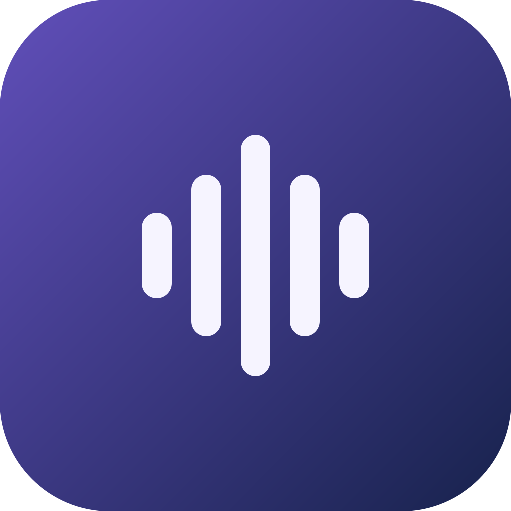

<div align="right">

**English** | [简体中文](README_CN.md)

</div>

<div align="center">



# 且听 · QieTing

**Listen at your own pace — A native macOS music player**

Swift / SwiftUI / AppKit · Talks directly to NetEase's real API · GitHub Actions test builds

[](#building)
[](Package.swift)
[](LICENSE)

</div>

**且听 (QieTing)** is the personal macOS fork [hoviksinn/kumone](https://github.com/hoviksinn/kumone), based on the open-source [missuo/kumone](https://github.com/missuo/kumone) project. It supports macOS 26.0 and later on Apple Silicon (arm64). Upstream copyright, licenses, and credits are retained.

## Name and Icon

The displayed app name is **且听**, with **QieTing** as its English identifier. This is a customization of Kumone, not a new claim of authorship over the upstream player. Internal Swift modules, the executable, the existing test Bundle ID, and data paths keep their names so login, settings, and cached music continue to work.

The original placeholder icon uses five sound ribbons on an indigo background. Its editable vector source lives in `AppIcon.icon`, compiled by Apple's `actool` into the app's native macOS icon. Run `python3 Scripts/generate-icon-preview.py` to regenerate the flat README preview; macOS supplies the actual Liquid Glass appearance.

## Features

- 🔐 **QR code login** — scan with the NetEase Cloud Music app; cookies are persisted locally and auto-refreshed
- 🏠 **Home** — daily recommendations, Personal FM, Heartbeat Mode, recommended playlists, radar playlists (Personal Radar family, personalized per account), charts, new albums, recommended artists
- 🧭 **Explore** — category playlists (curated / official / charts / mood) with infinite scrolling
- 🎵 **Playback** — AVAudioEngine playback, Standard to Hi-Res quality (lossless with 黑胶 VIP, automatic fallback), shuffle / repeat one / repeat all, play-next queue, gray track detection
- 🔓 **Gray track unblocking** — native implementation of UnblockNeteaseMusic's core sources (pyncmd / Kuwo / Kugou); unavailable or trial-only tracks automatically resolve from third-party sources
- 🖼 **Immersive now-playing page** — artwork-tinted gradient backdrop, large artwork, big synced lyrics (click the player-bar artwork to open, Esc to close)
- 📻 **Personal FM** — immersive roaming page with trash / skip
- 📝 **Lyrics** — full-height side region with synced lyrics, word-level lyrics and translation, click to seek
- 🪟 **Desktop lyrics** — LyricsX-style floating always-on-top lyric line with translation; draggable, persisted position, visible across Spaces and full-screen apps
- 📚 **Library** — liked songs, created / subscribed playlists, saved albums, followed artists, recently played, cloud disk
- ✏️ **Playlist management** — create / delete / subscribe playlists, add / remove tracks, heart songs
- 🔍 **Search** — aggregate / songs / artists / albums / playlists, trending keyword placeholder
- ⌨️ **System integration** — media keys / Control Center (Now Playing), scrobbling, playback queue restored across launches
- 🎛 **AutoMix and stem separation** — existing audio analysis, automatic transitions, and MLX / Metal stem separation
- 🌐 **Localization** — English and Simplified Chinese, following the system language

## Installing a Test Build

Requires macOS 26.0 or later and an Apple Silicon Mac. Intel Macs are no longer supported.

Open [Actions → CI](https://github.com/hoviksinn/kumone/actions/workflows/ci.yml) in this repository, choose a successful run, and download the artifact whose name contains `macOS26-arm64`. Extract the download and the App ZIP inside to obtain `且听.app`. See the [Chinese test-build guide](docs/MACOS_TEST_BUILDS_CN.md) for manual runs and safe testing instructions.

The downloaded app is named `且听.app` and the artifact begins with `QieTing-Test-macOS26-arm64`. It keeps the separate Bundle ID `com.hoviksinn.kumone.test` and updates disabled. Test builds use no upstream signing certificate or release secret and are not notarized by Apple. Keep the original Kumone app separate and use a separate macOS user account as described in the guide: some data paths still use upstream names. This repository does not provide Homebrew installation, production releases, or automatic updates.

## Building

Requires an Apple Silicon Mac, macOS 26.0+, and Xcode 26+. Linux supports static checks only; macOS GitHub Actions validates compilation, tests, and packaging.

```bash
swift build --triple arm64-apple-macosx26.0  # compile
make test                                 # prepare Metal kernels and run all tests
Scripts/build-app.sh           # package the .app (outputs .build/app/且听.app)
Scripts/compile_and_run.sh     # kill → repackage → relaunch
```

## Architecture

```
Sources/Kumone/
├── Core/
│   ├── API/            # NeteaseCrypto (weapi/eapi encryption), NeteaseClient (transport + cookies), NeteaseAPI (~50 endpoints)
│   ├── Models/         # unified Track model (tolerates both JSON shapes), lyrics parser
│   ├── Player/         # PlayerService (queue / shuffle / repeat / FM / URL resolution), UnblockService, NowPlayingManager
│   └── Storage/        # AccountStore, SettingsManager, two-tier image cache
├── DesignSystem/       # design tokens, button styles (hover scale / row highlight / chips), skeletons, cards, marquee, artwork palette
└── Features/           # pages + player bar + immersive now-playing + lyrics/queue panels
```

No third-party API server involved: weapi (double AES-CBC + RSA) and eapi
(AES-ECB + MD5 digest) encryption are implemented natively in Swift, and
requests go straight to `music.163.com` / `interface.music.163.com`.

## Related projects

For a separate **tvOS** client, upstream recommends [Sonimbus](https://github.com/gee1k/sonimbus), a NetEase Cloud Music client for Apple TV maintained by Svend.

## Credits

This customization is based on **Kumone by missuo** ([upstream](https://github.com/missuo/kumone), © 2026 missuo, LGPL-3.0-only). The upstream Swift implementation credits the following projects for design and implementation ideas:

- [YesPlayMusic](https://github.com/qier222/YesPlayMusic) (MIT, © qier222) — feature design, NetEase API endpoints and behavior
- [kaset](https://github.com/sozercan/kaset) (MIT, © sozercan) — UI design system, motion, and SwiftPM packaging approach
- [UnblockNeteaseMusic/server](https://github.com/UnblockNeteaseMusic/server) (LGPL-3.0-only) — third-party source endpoints and matching strategy for gray tracks (`UnblockService.swift` is an independent Swift reimplementation)
- [LyricsX](https://github.com/ddddxxx/LyricsX) (MPL-2.0, © ddddxxx) — desktop lyrics window design reference (window configuration, screen-factor positioning; `DesktopLyrics.swift` is an independent SwiftUI implementation)

## License

Licensed under [LGPL-3.0-only](LICENSE) (the [GPL-3.0](COPYING) text is
included alongside). For learning and personal use only — all music data and
rights belong to NetEase Cloud Music and the respective source platforms. Music downloads and caching use the existing upstream capabilities; no social features are added.
